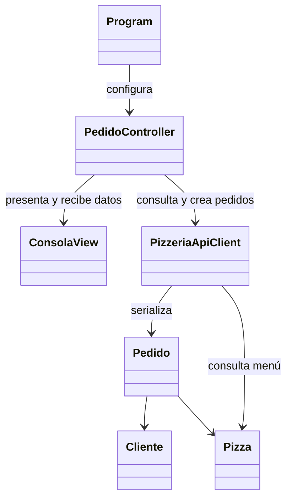
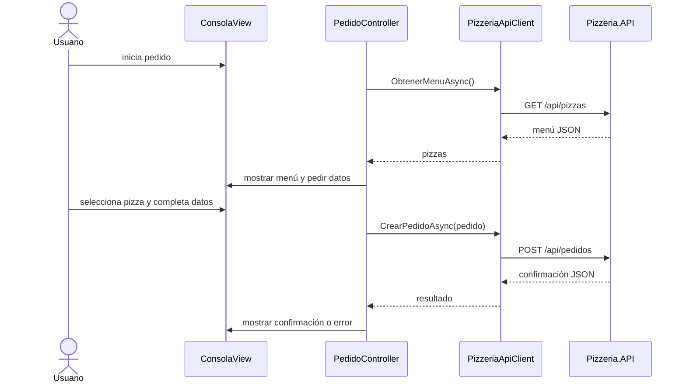
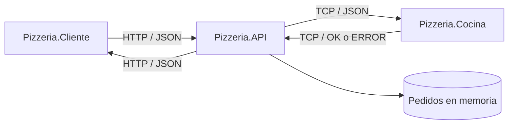

# Proyecto Pizzería Distribuida

Proyecto educativo en C#/.NET 10 para simular el pedido y la entrega de una pizza mediante una arquitectura distribuida.

## Arquitectura

- **Pizzeria.Cliente:** aplicación de consola que consume la API REST y organiza la interacción con MVC.
- **Pizzeria.API:** backend con Minimal API. Registra pedidos y los envía a cocina mediante TCP sockets.
- **Pizzeria.Cocina:** servicio independiente que escucha pedidos por TCP y responde con una confirmación.
- **Pizzeria.Modelos:** biblioteca compartida con `Pizza`, `Cliente`, `Pedido` y `EstadoPedido`.

### MVC en el cliente

- **Modelo:** las entidades compartidas `Pizza`, `Cliente` y `Pedido` representan los datos del dominio. `PizzeriaApiClient` encapsula las solicitudes HTTP y la lectura de las respuestas de la API.
- **Vista:** `ConsolaView` muestra el menú, solicita los datos al usuario y presenta errores o la confirmación del pedido.
- **Controlador:** `PedidoController` coordina la vista y el acceso al modelo; valida la selección y ejecuta las operaciones de red de forma asincrónica.
- **Punto de entrada:** `Program.cs` configura el cliente HTTP y conecta las dependencias.

## Tecnologías

- C# / .NET 10
- MVC en la aplicación cliente
- Minimal APIs
- HTTP/REST
- Swagger/OpenAPI
- TCP sockets
- `async/await`
- Manejo de excepciones

## Cómo ejecutar

Abrir la solución `PizzeriaDistribuida.slnx` en Visual Studio.

Ejecutar primero **Pizzeria.Cocina** y después **Pizzeria.API**. Finalmente ejecutar **Pizzeria.Cliente**.

La API queda disponible en:

`http://localhost:5029`

Swagger:

`http://localhost:5029/swagger`

La cocina escucha en:

`127.0.0.1:5000`

## Flujo

1. El cliente consulta el menú mediante `GET /api/pizzas`.
2. El cliente envía el pedido mediante `POST /api/pedidos`.
3. La API registra el pedido con estado `EsperaDeConfirmacion`.
4. La API se comunica con Cocina mediante un socket TCP.
5. Cocina recibe el pedido, lo procesa y responde `OK`.
6. Si la comunicación fue correcta, la API cambia el pedido a `EnPreparacion`.
7. Si Cocina no está disponible, el pedido queda registrado y la API informa el problema.

## Casos de uso y responsabilidades

- **Cliente:** consulta el menú, recopila los datos del cliente y las pizzas elegidas, envía el pedido por HTTP y muestra el resultado.
- **API:** valida los datos y las pizzas, asigna ID/fecha/estado, registra el pedido y delega su preparación en Cocina mediante TCP.
- **Cocina:** recibe el pedido por TCP, informa sus datos y responde `OK` o `ERROR`.

El caso de uso principal es **Realizar pedido**: Cliente → API (`GET /api/pizzas`, `POST /api/pedidos`) → Cocina (TCP) → API → Cliente. La consulta de un pedido se realiza con `GET /api/pedidos/{id}` y su estado se actualiza con `PATCH /api/pedidos/{id}/estado`.

## Errores y reintentos

La API intenta conectar con Cocina hasta 3 veces, con una espera creciente entre intentos. Los reintentos se limitan al establecimiento de la conexión; si el pedido ya fue enviado y falla la respuesta, no se reenvía para evitar duplicar su procesamiento. Los errores y tiempos de espera quedan registrados en el log de la API. Si no se obtiene confirmación, el pedido permanece registrado en `EsperaDeConfirmacion` y la respuesta indica que Cocina no pudo ser contactada. La cancelación de la solicitud HTTP se propaga en lugar de tratarse como una caída de Cocina.

## Pruebas manuales de la demo

1. Iniciar Cocina y luego la API; consultar `GET /api/pizzas` desde Swagger o con el cliente.
2. Enviar un pedido válido con `POST /api/pedidos` y comprobar que la respuesta informa `cocinaConectada: true`, el estado cambia a `EnPreparacion` y Cocina muestra el pedido.
3. Consultar el pedido con `GET /api/pedidos/{id}` y actualizar su estado con `PATCH /api/pedidos/{id}/estado`.
4. Detener Cocina y enviar otro pedido. Verificar que se ejecutan los reintentos en el log, que la API informa `cocinaConectada: false` y que el pedido sigue registrado en `EsperaDeConfirmacion`.
5. Enviar un pedido sin cliente, sin pizzas o con un ID de pizza inexistente. Verificar que la API responde `400 Bad Request` con un mensaje de validación.

Estas pruebas también cubren los escenarios funcionales principales (consultar menú, crear pedido y consultar/actualizar su estado) y los casos de error de validación, respuesta inválida, timeout y API no disponible. Las solicitudes HTTP usan `async/await` y un timeout para no bloquear la interacción ni esperar indefinidamente.

## Estados del pedido

- `EsperaDeConfirmacion`
- `EnPreparacion`
- `EnViaje`
- `Entregado`

## Manejo de errores

Se contemplan errores de validación, API no disponible, timeout, cocina desconectada, errores de socket, errores de lectura/escritura y JSON inválido.
